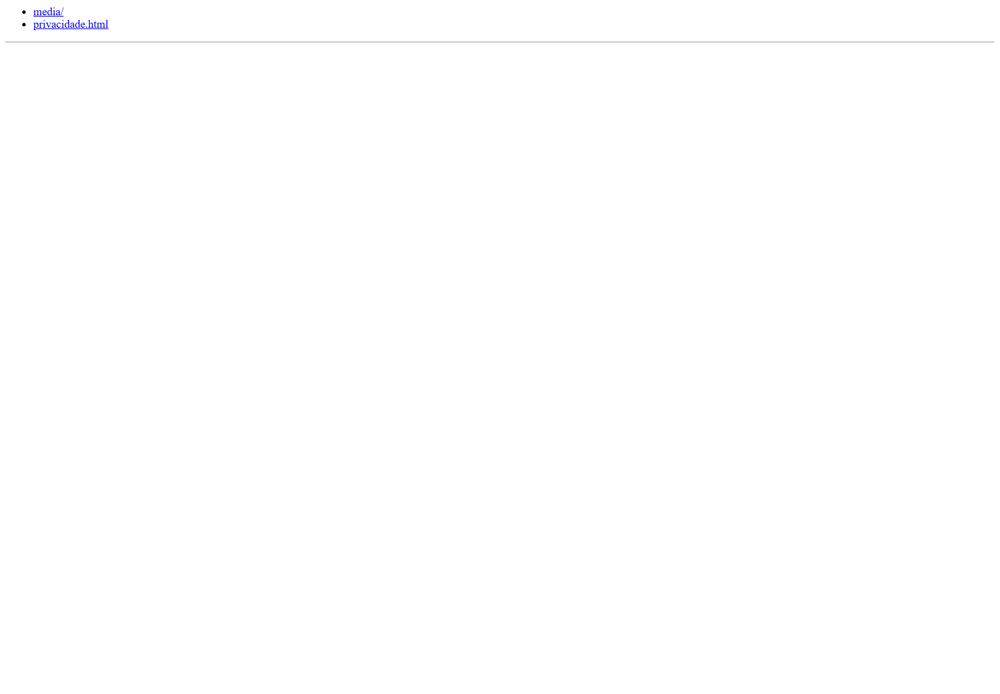
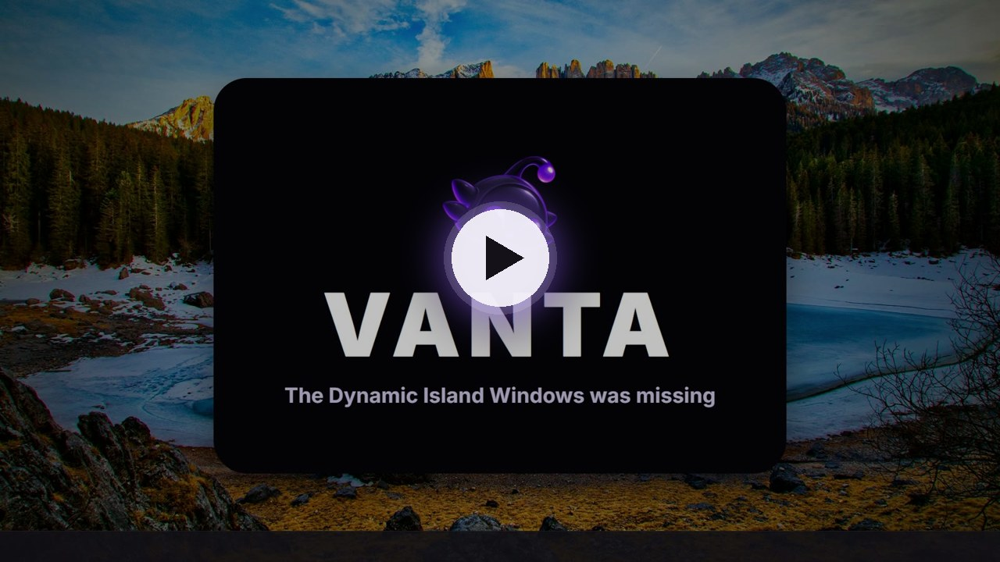
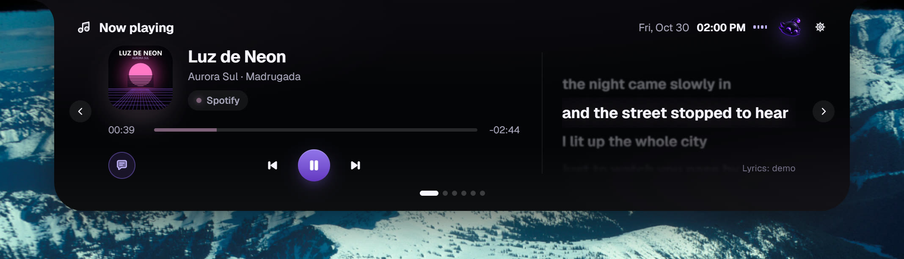
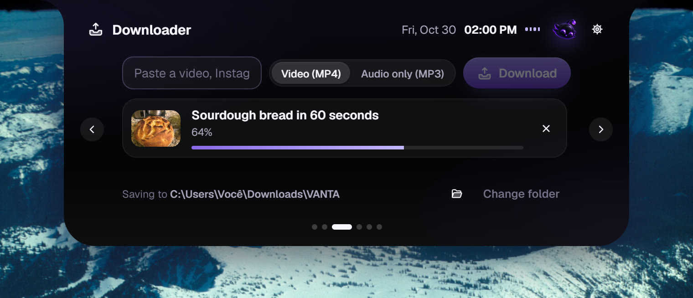
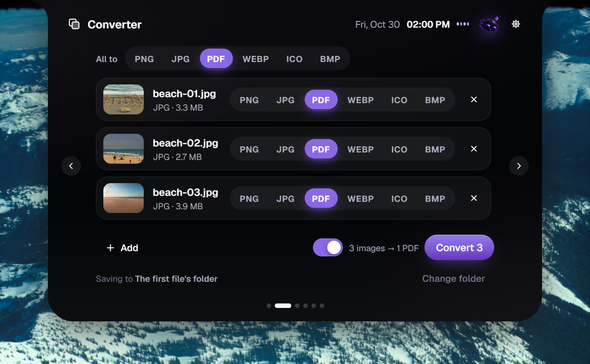
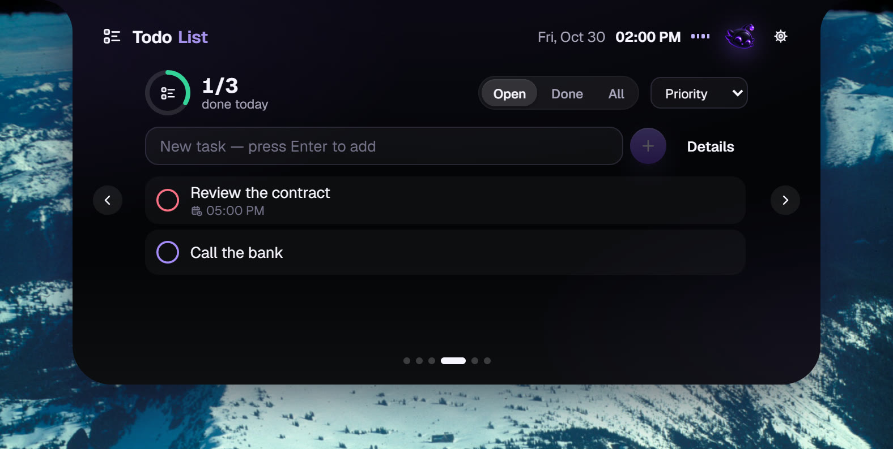
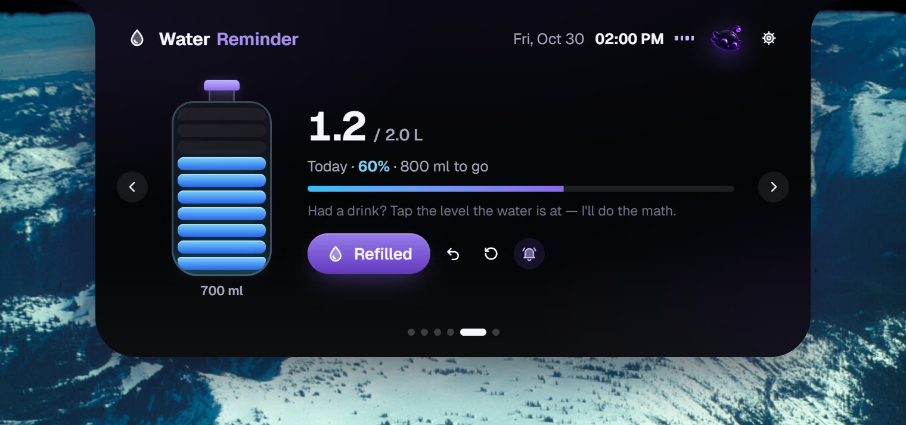

<div align="center">


# VANTA

**A Dynamic Island for Windows.**
Now playing with synced lyrics, a file converter, link downloads, tasks and water tracking,
all in one capsule at the top of your screen.

[](https://github.com/qamut/vanta/releases/latest)
[](https://github.com/qamut/vanta/releases)
[](LICENSE)


[**Download for Windows**](https://vanta.notrix.com.br/#baixar) ·
[Website](https://vanta.notrix.com.br) ·
[Releases](https://github.com/qamut/vanta/releases) ·
[Português](README.pt-BR.md)

<br />



</div>

---

## Watch it in 55 seconds

[](https://vanta.notrix.com.br/#video)

## What it does

<table>
  <tr>
    <td width="50%"></td>
    <td width="50%"></td>
  </tr>
  <tr>
    <td><b>Now playing, with lyrics in time.</b> Spotify, YouTube, Apple Music, Deezer or any player that talks to Windows. Artwork, timeline, controls, and synced lyrics side by side.</td>
    <td><b>Copied a link? It tells you.</b> Videos from YouTube, TikTok, Instagram, X and Pinterest as MP4, or just the audio as MP3, in the folder you choose.</td>
  </tr>
  <tr>
    <td></td>
    <td></td>
  </tr>
  <tr>
    <td><b>Drop and convert.</b> Photos to PDF, PDF to images, video to MP3. PNG, JPG, WEBP, ICO, BMP, MP4, WEBM, GIF, WAV, M4A, OGG and more, powered by a bundled FFmpeg.</td>
    <td><b>Today's tasks.</b> Priority, due date, reminders, filters and the day's progress, one gesture away.</td>
  </tr>
  <tr>
    <td></td>
    <td></td>
  </tr>
  <tr>
    <td><b>Drink water, for real.</b> Tell it your bottle size, then tap the level the water dropped to. VANTA counts the rest and reminds you.</td>
    <td><b>Out of the way.</b> Collapsed, it is a notch fused to the top edge. It never steals focus, and clicks outside the capsule go straight to the app underneath.</td>
  </tr>
</table>

Also: native Windows notifications from VANTA, headphone, charger and low-battery alerts, an optional browser extension that names the exact site playing (YouTube, Netflix, Prime Video, Spotify Web, Twitch and more), Portuguese and English UI.

## Install

1. Download **`VANTA-Setup-1.0.0.exe`** from the [website](https://vanta.notrix.com.br/#baixar) or the [latest release](https://github.com/qamut/vanta/releases/latest).
2. Run it. It installs for your user only, without asking for administrator rights.
3. The capsule appears at the top of your main monitor, and an icon sits in the tray.

> [!NOTE]
> The installer is not code-signed yet, so Windows SmartScreen may show *"Windows protected your PC"*. Click **More info → Run anyway**. Each release lists the SHA-256 of every file so you can verify what you downloaded.

**Silent install:** `VANTA-Setup-1.0.0.exe --silent [--no-autostart] [--no-desktop]`
**Alternatives:** `VANTA_1.0.0_x64-nsis.exe` (standard NSIS) and `VANTA_1.0.0_x64_pt-BR.msi`.
**Uninstall:** Windows Settings → Apps → VANTA. Your data in `%APPDATA%\app.vanta.island` is removed only if you choose to.

**Requirements:** Windows 10 or 11, 64-bit. WebView2 ships with Windows 11; on Windows 10 the installer fetches Microsoft's official bootstrapper if it is missing.

## Use

| Gesture | Effect |
|---|---|
| Hover the capsule | Expands after a short intent delay |
| Click | Expands; click outside or `Esc` collapses |
| `Alt` + `Shift` + `Space` (configurable) | Opens with keyboard focus: `←` `→` switch module, `1`–`9` jump, `Esc` closes |
| Drag the capsule | Moves it aside; it returns 5 s after you let go |
| Drag the edges (expanded) | Resizes; double-click an edge to reset |
| Drop files on the capsule | Opens the converter with the files queued |
| Copy a video link | The island offers to download it (can be turned off) |
| Gear icon or tray | Settings open inside the island itself |

## Privacy

VANTA has no account, no server, no ads and no telemetry. Tasks, water logs and preferences stay in `%APPDATA%\app.vanta.island`. Only two things ever leave your computer, and only when you use them: the track name sent to [LRCLIB](https://lrclib.net) to find lyrics (can be turned off), and the link you ask it to download. Full policy: [vanta.notrix.com.br/privacidade](https://vanta.notrix.com.br/privacidade).

## Build from source

Requirements: Windows 10/11 x64, Node 22+, Rust stable (MSVC toolchain), WebView2.

```bash
git clone https://github.com/qamut/vanta.git
cd vanta
npm ci
npm run ffmpeg:fetch     # downloads the pinned FFmpeg build and checks its SHA-256
npm run desktop          # run the app in development mode
```

| Command | What it does |
|---|---|
| `npm test` | Frontend tests (Vitest + Testing Library) |
| `npm run typecheck` · `npm run lint` | TypeScript strict and ESLint |
| `cd src-tauri && cargo test` · `cargo clippy --all-targets` | Rust tests and lints |
| `npm run release` | Browser extension + app + NSIS/MSI + the custom installer, into `release/` |

### Project layout

```
src/                 React 19 UI of the island (TypeScript strict, Motion, Zustand)
src-tauri/           Rust core: window, media sessions, audio, power, converter, downloader, lyrics, native bridge
browser-extension/   Optional Chromium/Firefox extension (Native Messaging, no network access)
installer/           The custom setup app (Tauri + plain HTML/CSS/JS) that wraps the NSIS installer
web/                 The website at vanta.notrix.com.br (Vite, React, Tailwind, shadcn, Paper shaders)
docs/                Architecture, validation notes and README media
```

Architecture and design decisions: [docs/ARCHITECTURE.md](docs/ARCHITECTURE.md). What was tested and known limitations: [docs/VALIDATION.md](docs/VALIDATION.md).

## Contributing

Issues and pull requests are welcome. Read [CONTRIBUTING.md](CONTRIBUTING.md) first; to report a security issue privately, see [SECURITY.md](SECURITY.md).

## Third-party software

- **FFmpeg** is bundled as a separate program under the GPL v3, pinned to an exact build. Version, license and the exact source are in [`src-tauri/bin/FFMPEG-NOTICE.txt`](src-tauri/bin/FFMPEG-NOTICE.txt).
- **yt-dlp** (Unlicense) and **gallery-dl** (GPL v2) are not redistributed: VANTA downloads them from their official GitHub releases on first use and verifies yt-dlp by SHA-256.
- Lyrics come from **[LRCLIB](https://lrclib.net)**.

Download only content you own, content that is free, or content you are allowed to download. Each site's terms still apply.

## License

[MIT](LICENSE) © 2026 VANTA Labs. VANTA is not affiliated with Apple or Microsoft.
