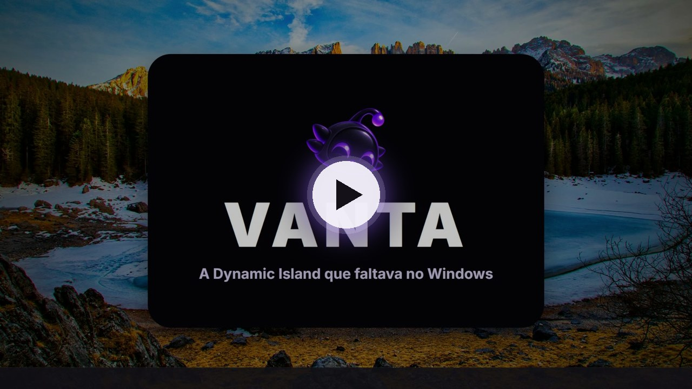
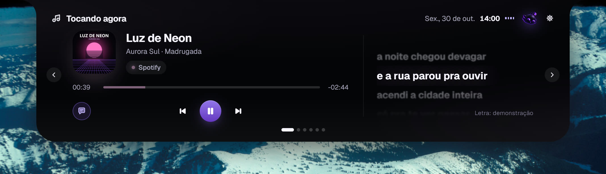
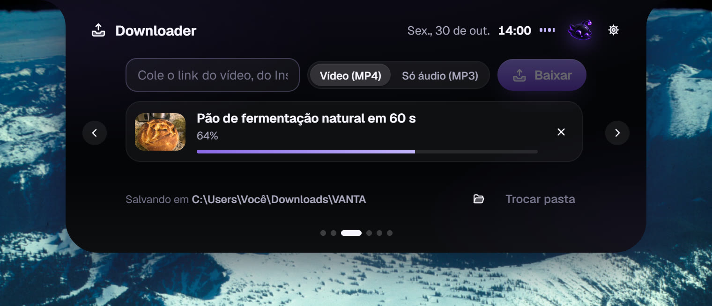
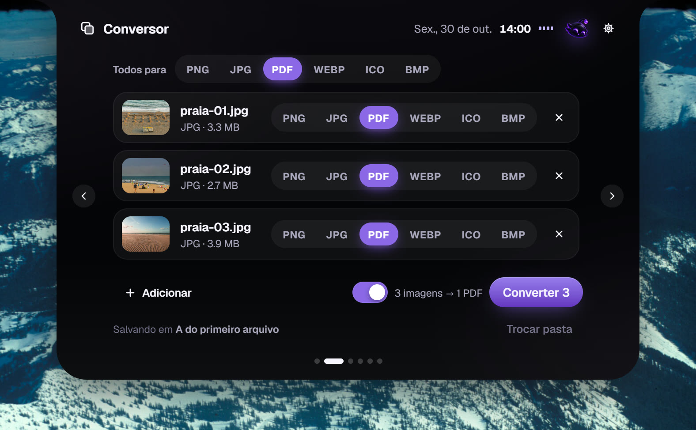
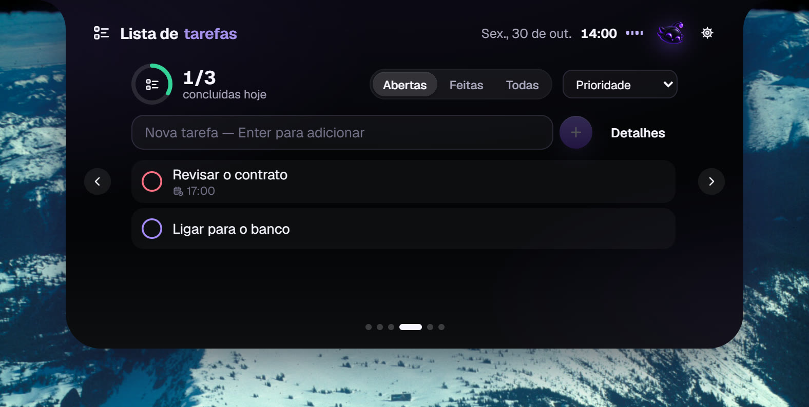
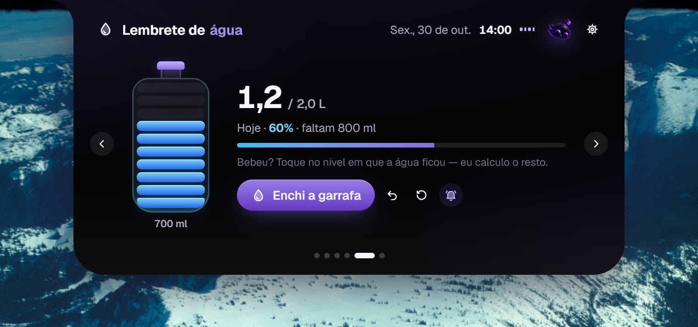

<div align="center">


# VANTA

**A Dynamic Island para o Windows.**
O que está tocando, com letra sincronizada, um conversor, downloads por link, tarefas e água,
numa cápsula no topo da tela.

[](https://github.com/qamut/vanta/releases/latest)
[](https://github.com/qamut/vanta/releases)
[](LICENSE)


[**Baixar para Windows**](https://vanta.notrix.com.br/#baixar) ·
[Site](https://vanta.notrix.com.br) ·
[Versões](https://github.com/qamut/vanta/releases) ·
[English](README.md)

<br />


</div>

---

## Veja em 55 segundos

[](https://vanta.notrix.com.br/#video)

## O que ele faz

<table>
  <tr>
    <td width="50%"></td>
    <td width="50%"></td>
  </tr>
  <tr>
    <td><b>Música com a letra no tempo certo.</b> Spotify, YouTube, Apple Music, Deezer ou qualquer player que fale com o Windows. Capa, linha do tempo, controles e a letra ao lado.</td>
    <td><b>Copiou um link? Ela avisa.</b> Vídeos do YouTube, TikTok, Instagram, X e Pinterest em MP4, ou só o áudio em MP3, na pasta que você escolher.</td>
  </tr>
  <tr>
    <td></td>
    <td></td>
  </tr>
  <tr>
    <td><b>Arraste e converta.</b> Fotos viram PDF, PDF vira imagem, vídeo vira MP3. PNG, JPG, WEBP, ICO, BMP, MP4, WEBM, GIF, WAV, M4A, OGG e mais, com o FFmpeg que vem junto.</td>
    <td><b>Tarefas do dia.</b> Prioridade, prazo, lembrete, filtros e o progresso do dia, a um gesto de distância.</td>
  </tr>
  <tr>
    <td></td>
    <td></td>
  </tr>
  <tr>
    <td><b>Beba água de verdade.</b> Diga o tamanho da sua garrafa e toque no nível em que a água ficou. O VANTA conta o resto e lembra você.</td>
    <td><b>Fora do caminho.</b> Recolhida, ela é um notch encostado no topo. Não rouba o foco, e fora da cápsula os cliques vão direto para o app de baixo.</td>
  </tr>
</table>

E ainda: notificações do VANTA na central do Windows, avisos de fone, carregador e bateria baixa, uma extensão opcional que mostra o site exato que está tocando (YouTube, Netflix, Prime Video, Spotify Web, Twitch e outros) e interface em português e inglês.

## Instalar

1. Baixe o **`VANTA-Setup-1.0.0.exe`** no [site](https://vanta.notrix.com.br/#baixar) ou na [última versão](https://github.com/qamut/vanta/releases/latest).
2. Execute. Ele instala só para o seu usuário, sem pedir administrador.
3. A cápsula aparece no topo do monitor principal, e um ícone fica na bandeja.

> [!NOTE]
> O instalador ainda não tem assinatura digital, então o SmartScreen pode mostrar *"O Windows protegeu o computador"*. Clique em **Mais informações → Executar assim mesmo**. Cada versão traz o SHA-256 de todos os arquivos, para você conferir o que baixou.

**Instalação silenciosa:** `VANTA-Setup-1.0.0.exe --silent [--no-autostart] [--no-desktop]`
**Alternativas:** `VANTA_1.0.0_x64-nsis.exe` (NSIS padrão) e `VANTA_1.0.0_x64_pt-BR.msi`.
**Desinstalar:** Configurações do Windows → Aplicativos → VANTA. Seus dados em `%APPDATA%\app.vanta.island` só são apagados se você escolher.

**Requisitos:** Windows 10 ou 11, 64 bits. O WebView2 já vem no Windows 11; no Windows 10 o instalador baixa o instalador oficial da Microsoft se faltar.

## Usar

| Gesto | Efeito |
|---|---|
| Passar o mouse sobre a cápsula | Expande depois de um breve atraso de intenção |
| Clique | Expande; clique fora ou `Esc` recolhe |
| `Alt` + `Shift` + `Espaço` (configurável) | Abre com o teclado: `←` `→` troca de módulo, `1`–`9` vai direto, `Esc` fecha |
| Arrastar a cápsula | Afasta a ilha; ela volta 5 s depois de soltar |
| Arrastar as bordas (expandida) | Redimensiona; duplo clique na borda volta ao padrão |
| Soltar arquivos na cápsula | Abre o conversor com os arquivos na fila |
| Copiar um link de vídeo | A ilha oferece baixar (dá para desligar) |
| Engrenagem ou bandeja | As configurações abrem dentro da própria ilha |

## Privacidade

O VANTA não tem conta, servidor, anúncios nem telemetria. Tarefas, água e preferências ficam em `%APPDATA%\app.vanta.island`. Só duas coisas saem do computador, e só quando você usa: o nome da música, enviado ao [LRCLIB](https://lrclib.net) para buscar a letra (dá para desligar), e o link que você manda baixar. Política completa: [vanta.notrix.com.br/privacidade](https://vanta.notrix.com.br/privacidade).

## Compilar

Requisitos: Windows 10/11 x64, Node 22+, Rust estável (MSVC), WebView2.

```bash
git clone https://github.com/qamut/vanta.git
cd vanta
npm ci
npm run ffmpeg:fetch     # baixa a build fixa do FFmpeg e confere o SHA-256
npm run desktop          # app em modo de desenvolvimento
```

| Comando | O que faz |
|---|---|
| `npm test` | Testes do frontend (Vitest + Testing Library) |
| `npm run typecheck` · `npm run lint` | TypeScript strict e ESLint |
| `cd src-tauri && cargo test` · `cargo clippy --all-targets` | Testes e lints do Rust |
| `npm run release` | Extensão + app + NSIS/MSI + instalador próprio, em `release/` |

Arquitetura e decisões: [docs/ARCHITECTURE.md](docs/ARCHITECTURE.md). O que foi testado e limitações conhecidas: [docs/VALIDATION.md](docs/VALIDATION.md).

## Contribuir

Issues e pull requests são bem-vindos. Leia o [CONTRIBUTING.md](CONTRIBUTING.md) antes; para relatar uma falha de segurança em particular, veja o [SECURITY.md](SECURITY.md).

## Software de terceiros

- **FFmpeg** vai junto como programa separado, sob a GPL v3, numa build fixa. Versão, licença e o código-fonte exato estão em [`src-tauri/bin/FFMPEG-NOTICE.txt`](src-tauri/bin/FFMPEG-NOTICE.txt).
- **yt-dlp** (Unlicense) e **gallery-dl** (GPL v2) não são redistribuídos: o VANTA baixa os dois dos releases oficiais no GitHub no primeiro uso e confere o yt-dlp por SHA-256.
- As letras vêm do **[LRCLIB](https://lrclib.net)**.

Baixe apenas o que é seu, o que é livre ou o que você tem autorização para baixar. Os termos de cada site continuam valendo.

## Licença

[MIT](LICENSE) © 2026 VANTA Labs. O VANTA não é afiliado à Apple nem à Microsoft.
